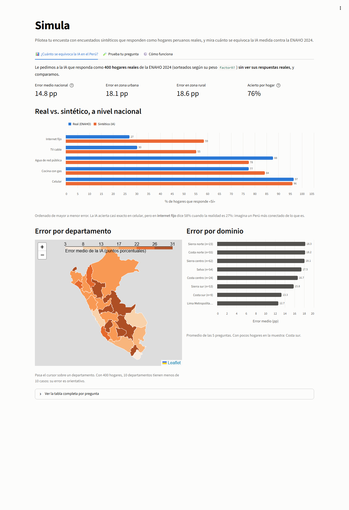
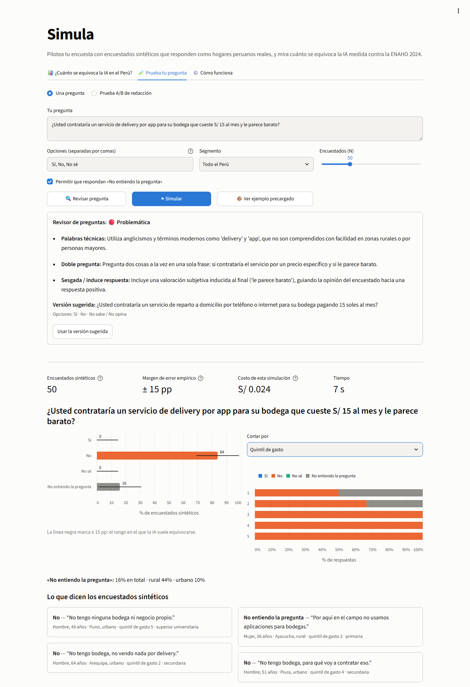
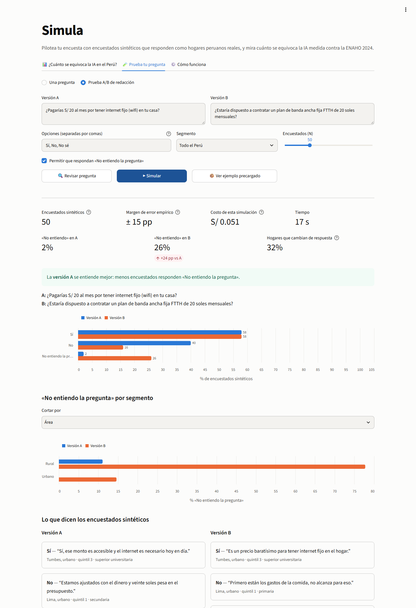
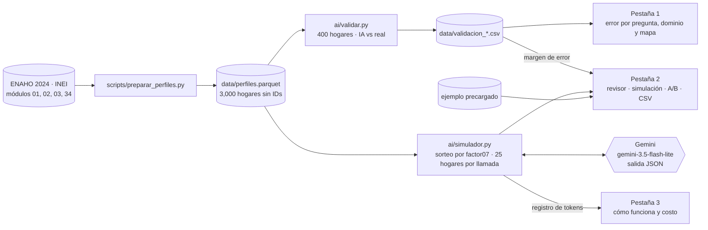

# Simula

> **Hacemos el piloto de tu encuesta con encuestados sintéticos que responden como hogares peruanos reales, y te decimos cuánto se equivoca la IA porque la medimos contra la ENAHO.**

**Demo:** [URL] · Proyecto final del curso Data Science con Python, Universidad del Pacífico, 2026-II.

---

## 1. One-liner

Simula es un **piloto de encuestas con IA para el Perú**. Escribes tu pregunta y eliges un segmento (todo el Perú,
Lima Metropolitana, urbano/rural o un dominio). La IA responde como **hogares reales de la ENAHO 2024** y te muestra
las respuestas, las preguntas que confunden y **cuánto se equivoca, medido contra datos reales**.

## 2. Founder


**Jazmín Galindo**, estudiante de Economía de la Universidad del Pacífico.

**Por qué yo:** Simula está en el cruce de lo que estudio, que son encuestas, microdatos del INEI y muestras con factores
de expansión, con un dolor que veo de cerca: mis compañeros pasan semanas consiguiendo respuestas para trabajos que
dependen de una encuesta bien hecha. Construí la startup sola, con agentes de IA cubriendo cada frente:

| Frente | Cómo lo cubrí |
|---|---|
| **Producto** | Definí el problema, el flujo único (revisar → simular → comparar A/B) y las decisiones clave (qué preguntas validar, cómo medir el error, 400 hogares). Están en `CLAUDE.md` y en el historial de commits. |
| **Ingeniería** | Claude Code escribió el código siguiendo mis instrucciones. Yo revisé cada parte y validé los números contra el INEI. |
| **Diseño** | Una app limpia de 3 pestañas, con una paleta consistente (azul = real, naranja = IA) y un ejemplo precargado para que el demo nunca falle. |
| **Ventas** | Hice 4 entrevistas con usuarios potenciales ([docs/research/](docs/research/)) y armé los precios con lo que me dijeron. |

## 3. Problema

**Quién:** (1) **estudiantes y tesistas** que necesitan una encuesta para un curso, una investigación o su tesis,
y (2) **equipos de empresas y consultoras** que encuestan a sus clientes.

**Cuánto les cuesta hoy** (según [4 entrevistas](docs/research/README.md), noviembre 2026):

| | Muestra | Tiempo | Gasto | Qué salió mal |
|---|---|---|---|---|
| [Estudiante, Branding](docs/research/entrevista_1.md) | 50 | ~1 semana | S/ 0 | Respuestas incoherentes en preguntas abiertas que **tuvieron que descartar** |
| [Estudiante UP, investigación](docs/research/entrevista_2.md) | 50 | ~2 semanas y 2 días | S/ 0 | Conseguir que la gente responda y complete la encuesta |
| [Profesional, retail](docs/research/entrevista_3.md) | ~300 | 1 día para armarla | **500 puntos del programa por encuestado** | Plantear las preguntas correctas y elegir el tipo de pregunta; las áreas quieren preguntar demasiado |
| [Estudiante, investigación](docs/research/entrevista_4.md) | 25 | 5 días | S/ 0 | Que la gente realmente conteste |

- **Para un estudiante, el costo es tiempo:** de **5 días a más de 2 semanas** por encuesta, aunque no gaste plata.
  Si una pregunta sale mal, ese esfuerzo se pierde o hay que repetirlo.
- **Para una empresa, el costo es plata:** paga incentivos por **cada** respuesta (300 personas × 500 puntos en el caso
  entrevistado). Una pregunta mal planteada desperdicia esos incentivos.

**Cómo lo resuelven hoy:** **no pilotean**, o "pilotean" mandando la encuesta a unos cuantos amigos o compañeros, que
no se parecen a la población que quieren estudiar.

## 4. Solución e insight

**La solución:** antes de salir a campo, Simula:

1. **Revisa la pregunta** (*Revisor de preguntas*): avisa si es ambigua, doble, sesgada, si tiene palabras técnicas
   o si a las opciones les falta algo, y propone una versión mejorada.
2. **La simula** con 30–100 hogares reales de la ENAHO 2024, sorteados según su factor de expansión (`factor07`).
   La IA responde como cada hogar, en primera persona, y puede decir **"No entiendo la pregunta"**.
3. **Compara redacciones** (*Prueba A/B*): dos versiones con **los mismos hogares**, lado a lado.
4. Entrega la distribución, cortes por segmento, citas, el **margen de error empírico** y un CSV.

**El insight:** los encuestados sintéticos ya existen, pero **nadie sabe cuánto se equivocan en el Perú**. En EE. UU.,
[Pew Research Center (30-sep-2026)](https://www.pewresearch.org/data-labs/2026/09/30/can-ai-stand-in-for-human-survey-takers-not-really/)
encontró que se desvían **12 puntos en promedio** de las respuestas humanas. Simula **mide ese error en el Perú** contra la
ENAHO y lo muestra junto a cada resultado. Ese es nuestro resultado propio ([docs/validacion.md](docs/validacion.md)):

| Pregunta (ENAHO 2024, 400 hogares) | % real | % IA | Error |
|---|---|---|---|
| ¿En tu hogar alguien tiene teléfono celular? (`p1142`) | 96.5% | 96.0% | **0.5 pp** |
| ¿Tu hogar tiene internet fijo (wifi o cable)? (`p114b1`) | 27.0% | 58.5% | **31.5 pp** |
| ¿Tu hogar tiene TV por cable o satelital? (`p1143`) | 30.3% | 55.3% | **25.0 pp** |
| ¿El agua viene principalmente de la red pública? (`p110`) | 87.8% | 77.5% | **10.3 pp** |
| ¿Cocinan principalmente con gas? (`p113a`) | 77.5% | 84.3% | **6.8 pp** |

- **Error medio nacional: 14.8 puntos** (urbano 18.1, rural 18.6); la IA acierta la respuesta del hogar en el 76% de los casos.
- **La IA imagina un Perú más conectado de lo que es:** sobreestima internet fijo, TV cable y gas, y subestima el agua de red pública.
- Entre los dominios con 10 o más hogares, el de más error es **Sierra norte** (18.3 pp) y el de menos, **Lima Metropolitana** (12.7 pp).

Por eso Simula **no vende la IA como verdad**: la vende como un **piloto rápido con su margen de error a la vista**.

## 5. Why now

- **Los LLMs se volvieron baratos y confiables en formato:** con salidas estructuradas (JSON validado), simular
  **100 encuestados cuesta S/ 0.05** y toma ~15 segundos (costo real medido, ver sección 7).
- **Los microdatos del INEI son públicos:** la ENAHO 2024 trae miles de hogares reales con su factor de expansión,
  así que los encuestados sintéticos pueden partir de perfiles reales y no inventados.
- **El escepticismo es reciente y medible:** el estudio de Pew (septiembre 2026) puso el error de la IA en la agenda.
  Quien mida ese error localmente tiene una ventaja de confianza.

## 6. Demo

**App en vivo:** [URL]

### Capturas

| ¿Cuánto se equivoca la IA? | Revisor + simulación | Prueba A/B |
|---|---|---|
|  |  |  |

En el ejemplo precargado, la versión *"¿Pagarías S/ 20 al mes por tener internet fijo (wifi) en tu casa?"* tiene
**4%** de "No entiendo"; la versión con *"plan de banda ancha fija FTTH"* sube a **29%**, con los mismos 100 hogares.

### Cómo correrlo en local

```bash
python -m venv .venv
.venv\Scripts\activate         # en Mac/Linux: source .venv/bin/activate
pip install -r requirements.txt
copy .env.example .env          # en Mac/Linux: cp .env.example .env  → y pega tu GEMINI_API_KEY
streamlit run app/streamlit_app.py
```

Se abre en `http://localhost:8501`. **Sin clave de Gemini la app igual funciona:** muestra la validación y el ejemplo
precargado. Para regenerar los datos: `python scripts/preparar_perfiles.py` (requiere los .dta de la ENAHO en
`datos_crudos/`) y `python -m ai.validar` (usa caché, no repite llamadas).

### Arquitectura



Versión detallada: [docs/arquitectura.md](docs/arquitectura.md).

### Modelo y por qué

- **`gemini-3.5-flash-lite`** (Google Gemini, plan gratuito) con el SDK `google-genai` y **salida estructurada**:
  las respuestas se validan con Pydantic y las opciones son una lista cerrada, así que la IA no puede inventar una respuesta.
- **Por qué este modelo:** es estable, responde en ~4 s por lote de 25 hogares y es barato. Probamos `gemini-3.8-flash`,
  pero no respondía, y `gemini-3.6-flash` estaba saturado (error 503). Para un demo en vivo pesa más la confiabilidad.
- **Robustez:** reintentos ante 429/5xx, caché en disco, segundo intento para hogares omitidos y un ejemplo
  precargado si la API falla.

## 7. Modelo de negocio

**Costo real** (medido con los tokens de cada llamada en `data/registro_tokens.csv`, a precio pagado de
`gemini-3.5-flash-lite`: US$ 0.30 / US$ 2.50 por millón de tokens de entrada/salida; tipo de cambio S/ 3.40):

| Unidad | Costo |
|---|---|
| 100 encuestados × 1 pregunta (4 llamadas, ~9,500 tokens de entrada y ~4,800 de salida) | **S/ 0.051** |
| Revisar una pregunta | **S/ 0.002** |

**Planes** (los precios incluyen IGV; precio de estudiante según las entrevistas, que mencionaron **S/ 20–60 por estudio**):

| | **Prueba** | **Estudio** (estudiantes) | **Empresa** |
|---|---|---|---|
| Precio | S/ 0 | **S/ 29 por estudio** (pago único) | **S/ 390 al mes** |
| Incluye | 3 preguntas × 50 encuestados, 5 revisiones | 10 preguntas × 100 encuestados, 3 pruebas A/B, revisor sin límite, CSV | 4 estudios al mes de 15 preguntas × 300 encuestados, 5 A/B por estudio, revisor, soporte |
| Para quién | Probar la herramienta | Trabajos de curso, investigación, tesis | Áreas de marketing, CX, lealtad; consultoras |
| Costo en tokens | S/ 0.09 | S/ 0.72 | S/ 12.51 al mes |
| Precio sin IGV (÷ 1.18) | — | S/ 24.58 | S/ 330.51 |
| Comisión de pago (supuesto 5%) | — | S/ 1.45 | S/ 19.50 |
| **Margen de contribución** | **−S/ 0.09** (costo de adquisición) | **S/ 22.41 (91%)** | **S/ 298.49 (90%)** |

- **S/ 29** está en el rango que dieron los estudiantes y cerca de los "unos S/ 30 en general" de la [entrevista 1](docs/research/entrevista_1.md).
- **El plan Empresa es una hipótesis:** la entrevistada de retail no dio un monto. Lo que sí sabemos es que ya gasta
  en incentivos por cada encuesta; falta validar el precio con más empresas y compararlo con ese gasto.
- **Costo de servidor:** hoy S/ 0 (Streamlit Community Cloud). Es un costo fijo, no por usuario: con un servidor pagado
  de unos S/ 100 al mes (supuesto), **5 estudios al mes** lo cubren.
- El tamaño de cada plan supone la app completa (varias preguntas por estudio). Hoy la app simula una pregunta a la vez.

### Competencia

| Alternativa | Lo bueno | Lo malo |
|---|---|---|
| **No hacer nada** (salir a campo directo) | Gratis | Los errores se descubren tarde, con el tiempo o los incentivos ya gastados |
| **Pilotear con 5 amigos** | Rápido y gratis | No representan a la población; Lima, universitarios, misma edad |
| **Plataformas de encuestados sintéticos** (en su mayoría de EE. UU.) | Rápidas, muchas funciones | Perfiles no peruanos y sin un error medido localmente |
| **Simula** | Hogares reales de la ENAHO, error medido y visible, en soles | Validada solo con preguntas de tenencia de servicios; no reemplaza el campo |

### Primeros 10 / 100 / 1,000 usuarios

- **10:** los 3 estudiantes entrevistados que dijeron que sí la usarían, más compañeros de cursos con encuesta en la UP.
- **100:** profesores de cursos de investigación y tesis que la recomienden para el piloto; grupos de tesistas.
- **1,000:** otras universidades, más un piloto con 2–3 empresas (empezando por el perfil de la [entrevista 3](docs/research/entrevista_3.md)).

### Riesgos

- **La IA se equivoca** (14.8 pp en promedio): la mitigación es mostrar el error siempre y venderla como piloto, no como resultado final.
- **El error en opinión y precios no está medido:** el siguiente paso es validar con preguntas de ese tipo.
- **Dependencia de un proveedor:** el código aísla la llamada al LLM, así que cambiar de modelo se hace en un solo archivo.

## 8. Herramientas del curso y dónde están

| Herramienta (sesión) | Dónde |
|---|---|
| **LLMs con salidas estructuradas** (08) | [ai/simulador.py](ai/simulador.py) (esquemas Pydantic con opciones cerradas, `_esquema_lote` y `Revision`; reintentos, caché, tokens) y [ai/prompts.py](ai/prompts.py) |
| **Dashboards con Streamlit** (05) | [app/streamlit_app.py](app/streamlit_app.py): 3 pestañas, métricas, gráficos Altair, descarga CSV, `st.cache_data`, `session_state` |
| **Mapas con GeoPandas / Folium** (06) | [app/streamlit_app.py](app/streamlit_app.py), pestaña 1: GeoJSON del curso leído con GeoPandas, unido por `FIRST_IDDP` y pintado con `folium.Choropleth` |
| **Evaluación y despliegue de productos de datos** (12) | [ai/validar.py](ai/validar.py) y [docs/validacion.md](docs/validacion.md) (IA vs ENAHO por segmento); registro de costo en `data/registro_tokens.csv`; despliegue en Streamlit Community Cloud con Secrets y `requirements.txt` fijado |
| Preparación y exploración de datos con pandas | [scripts/preparar_perfiles.py](scripts/preparar_perfiles.py): une 4 módulos de la ENAHO, quintiles ponderados y muestra sin identificadores; [notebooks/exploracion_enaho.ipynb](notebooks/exploracion_enaho.ipynb): verificación de cada variable y comparación con el INEI |

## 9. Qué hizo el agente (y qué hice yo)

Usé **Claude Code** como agente de programación. Para ser transparente:

**Lo que generó Claude Code:**
- El código de `scripts/`, `ai/` y `app/`, el diagrama de arquitectura y el borrador de este README.
- La descarga de la ENAHO y la **lectura de las etiquetas de cada variable** desde los .dta antes de usarlas.
- Hallazgos que me reportó y que revisé:
  - `p1144` incluye internet móvil prepago (91% de hogares), por eso sale tan alta.
  - En el .dta la variable se llama `p114b1`, aunque el diccionario dice `P1144B1`.
  - El código 9 de `p113a` es bosta/estiércol.
  - Según la Ficha Técnica, urbano = estratos 1–5.
- La validación de los porcentajes contra el informe TIC del INEI (celular: 95.1%, igual a la cifra del INEI).
- El hallazgo de que las encuestas **incompletas** (`result == 2`) tienen el módulo de hogar respondido y son sobre todo
  de Lima: al excluirlas, Lima Metropolitana pesaba 16.8% de los hogares en vez de 32.5% ([notebook](notebooks/exploracion_enaho.ipynb), sección 9).
- La búsqueda de los modelos Gemini del plan gratuito y la prueba de cuáles respondían.

**Lo que decidí y revisé yo:**
- La idea, el problema, el alcance y las reglas del proyecto (`CLAUDE.md`).
- Usar **internet fijo (`p114b1`)** en lugar de `p1144` como pregunta de validación, para que la prueba fuera exigente.
- Subir la validación de 200 a **400 hogares**.
- **Incluir las encuestas incompletas** (`result` 1 y 2), lo estándar en la ENAHO para variables del hogar, y rehacer
  perfiles, validación y ejemplo con ese criterio.
- Las **4 entrevistas**: las hice yo y escribí las notas. El agente solo corrigió una inconsistencia en el resumen.
- El rango de precios a partir de lo que dijeron los entrevistados, y la revisión de cada resultado antes de cada commit.

**Decisiones del agente que acepté:** cambiar a `gemini-3.5-flash-lite` porque el modelo más nuevo no respondía; el tipo de
cambio supuesto (S/ 3.40); y que la IA responda en lotes de 25 hogares.

---

**Datos:** ENAHO 2024, INEI (código 966). Los microdatos no se suben al repo; solo se publican archivos derivados sin
identificadores. **Licencia:** [MIT](LICENSE).
