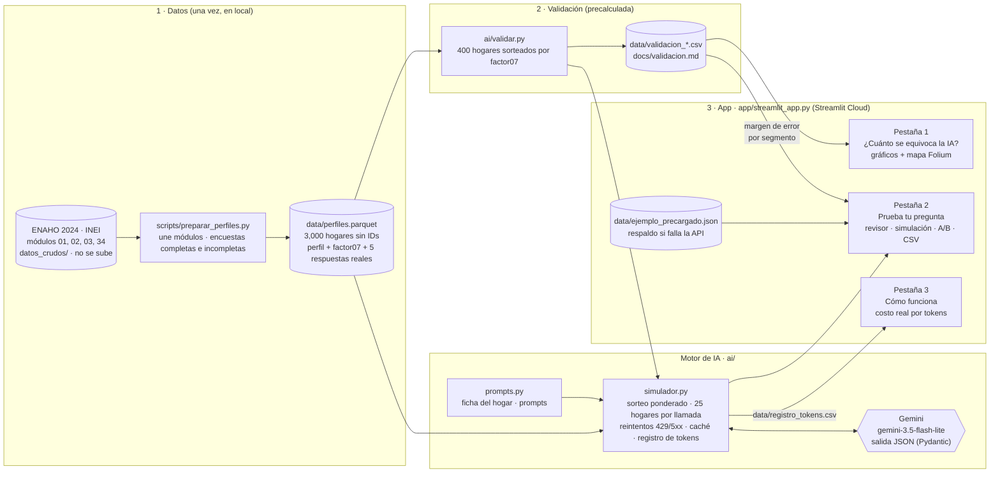

# Arquitectura de Simula

**Cómo leerlo:** los microdatos de la ENAHO se procesan una sola vez en local y quedan como 3,000 perfiles
sin identificadores. La validación usa esos perfiles para medir el error de la IA, y la app muestra ese error
(pestaña 1) y lo usa como margen empírico de cada simulación en vivo (pestaña 2).
